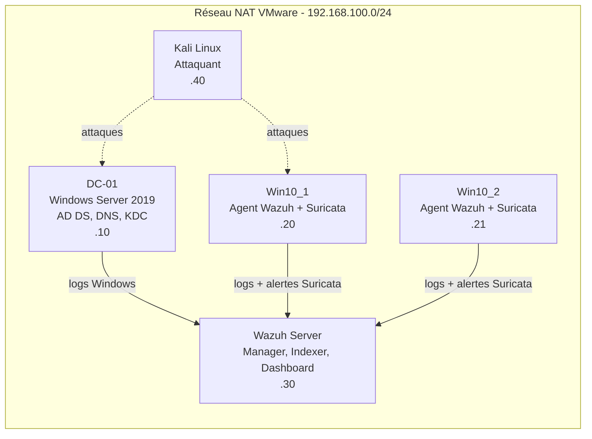

# Infrastructure Active Directory avec SOC intégré
### Détection de 4 attaques Active Directory avec Wazuh SIEM et Suricata

---

## Objectif

Projet de fin d'année (PFA) réalisé à l'**ENSAO** (École Nationale des Sciences Appliquées d'Oujda, filière Sécurité Informatique et Cyber Sécurité), soutenu le 30 juin 2025.

Un laboratoire Active Directory volontairement vulnérable est attaqué pour tester la capacité de détection d'un SOC basé sur Wazuh et Suricata. Quatre attaques classiques visant l'authentification AD sont simulées, puis détectées et cartographiées avec MITRE ATT&CK.

## Architecture du lab

Laboratoire isolé sous VMware Workstation, sur un seul réseau NAT (`192.168.100.0/24`, passerelle `192.168.100.2`).

| Machine | Système | Rôle | Adresse IP |
|---|---|---|---|
| DC-01 | Windows Server 2019 | AD DS, DNS, Kerberos KDC, agent Wazuh | 192.168.100.10 |
| Win10_1 | Windows 10 Pro | Client AD, agent Wazuh, Suricata | 192.168.100.20 |
| Win10_2 | Windows 10 Pro | Client AD, agent Wazuh, Suricata | 192.168.100.21 |
| Wazuh Server | Ubuntu Server 22.04 | SIEM (all-in-one) | 192.168.100.30 |
| Kali Linux | Kali Linux | Machine d'attaque | 192.168.100.40 |

## Outils utilisés
 
- **Défense (Blue Team)** : Wazuh (règles XML personnalisées), Suricata, Wireshark (analyse de signature), Event Viewer
- **Attaque (Red Team)** : Responder, Impacket, Evil-WinRM, Mimikatz, Hashcat

## Matrice de détection MITRE ATT&CK

| Attaque | Technique | Source de log | Règle / signature | Niveau | Résultat |
|---|---|---|---|---|---|
| LLMNR Poisoning | T1557.001 | Suricata `eve.json` (postes) | Signature UDP 5355, règle Wazuh 86601 | 3 | Détectée |
| Kerberoasting | T1558.003 | Windows Security, event 4769 | Wazuh 110002, chiffrement RC4 (0x17) | 12 | Détectée |
| DCSync | T1003.006 | Windows Security, event 4662 | Wazuh 110001, GUID de réplication | 12 | Détectée |
| Golden Ticket | T1558.001 | Windows Security, event 4624 | Wazuh 110003, LogonGuid nul + LogonType 3 | 12 | Détectée |

## Résultats

Les 4 attaques simulées ont généré une alerte dans le dashboard Wazuh pendant les tests, soit **4/4 détectées**. Aucune alerte parasite n'a été observée sur les règles Kerberoasting, DCSync et Golden Ticket. LLMNR est détecté par le réseau (Suricata) car il ne laisse pas de trace exploitable dans les logs Windows.

## Limites et améliorations

- **Faux positifs LLMNR** : la règle détecte toute réponse LLMNR, légitime ou non. Elle doit être affinée.
- **Niveau d'alerte trop bas (3)** : une tentative de poisoning devrait être remontée à 8-10 via une règle Wazuh enfant.
- **Suricata sur les postes** : choix adapté à un lab NAT sans port miroir. En production, on utiliserait une sonde dédiée sur port SPAN/TAP, centralisée vers le SIEM.
- **Prévention** : LLMNR est laissé actif volontairement pour permettre l'attaque. En production, il serait désactivé par GPO, la détection restant **une défense en profondeur**.

## Compétences démontrées

- **Active Directory** : déploiement d'un domaine, GPO, SPN, compréhension de Kerberos et NTLM
- **SOC / SIEM** : déploiement de Wazuh, collecte de logs Windows, écriture de règles de détection
- **Sécurité réseau** : Suricata, analyse de trafic avec Wireshark
- **Sécurité offensive** : simulation d'attaques AD, mapping MITRE ATT&CK

## Rapport et avertissement

Démarche détaillée, configuration, commandes, règles et analyse complète : **[Rapport technique (PDF)](docs/rapport_technique_AD_SOC.pdf)**

> Projet réalisé dans un environnement de laboratoire isolé, à des fins pédagogiques uniquement. Les techniques d'attaque présentées ne doivent jamais être utilisées contre des systèmes sans autorisation explicite.
